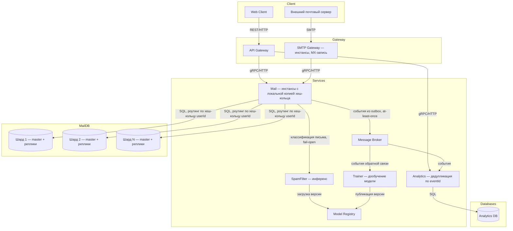
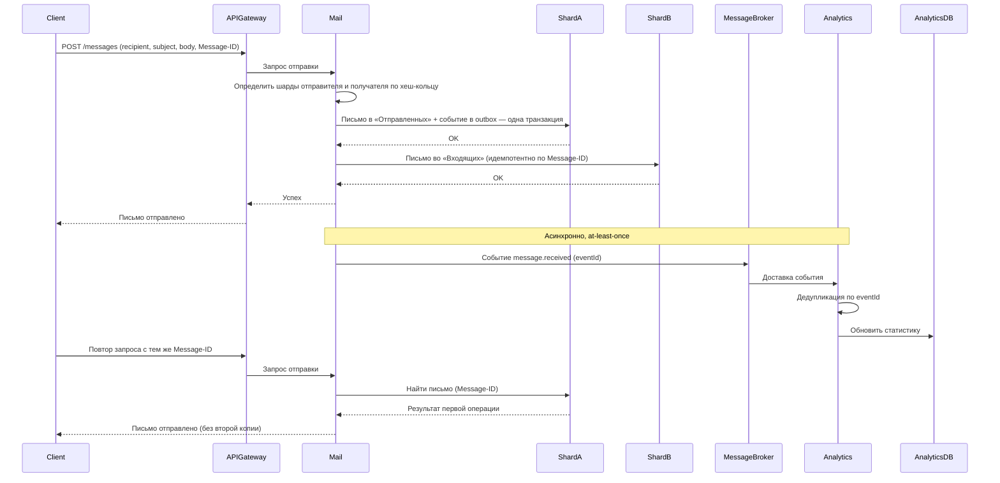
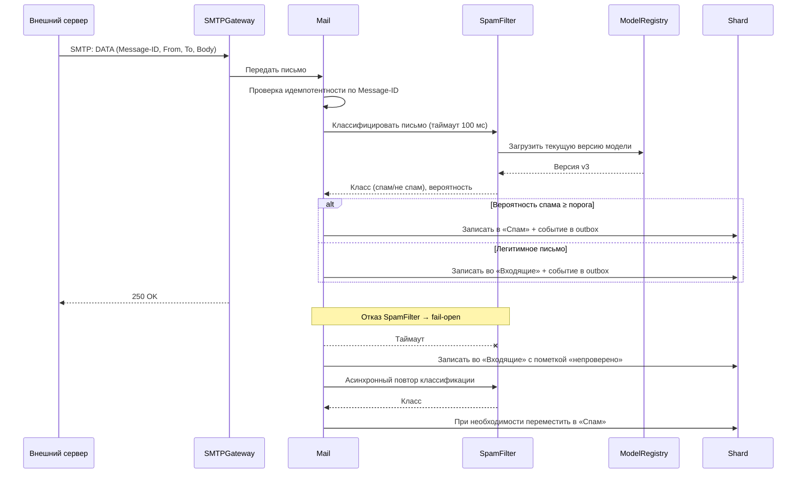
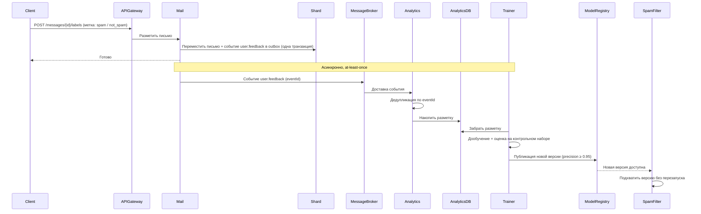
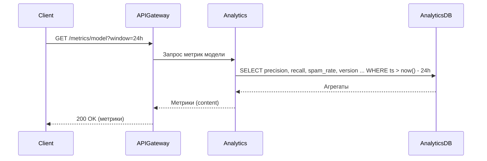
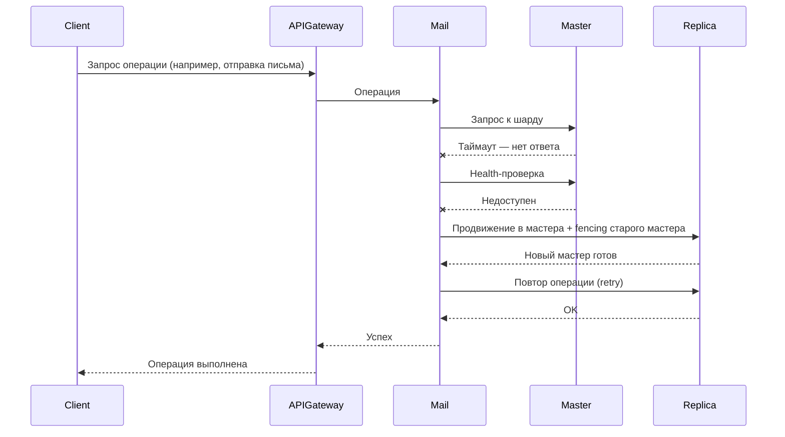
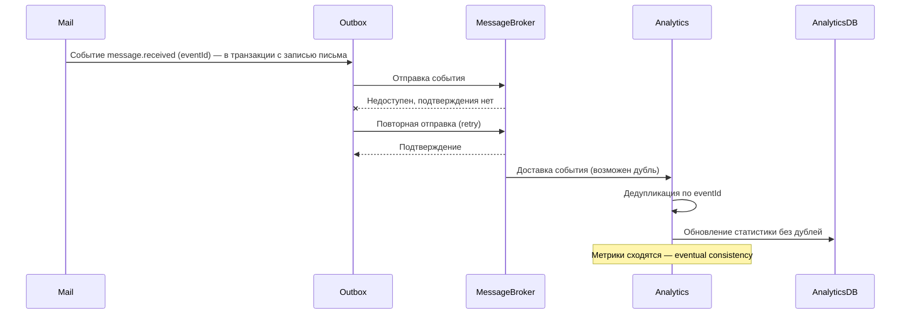

# Техническое решение проекта «Почтовый сервер с защитой от спама»

## Введение

- **Краткое описание:**  
  «Почтовый сервер с защитой от спама» — учебный проект, реализующий прототип распределённой почтовой системы с ML-классификацией входящих писем. Система позволяет отправлять и получать письма по протоколу SMTP, читать почту через веб-интерфейс, автоматически отделять спам от легитимных писем с помощью ML-модели и наблюдать качество модели через панель метрик. Обратная связь пользователей («спам» / «не спам») используется для периодического переобучения модели. Проект демонстрирует ключевые принципы построения отказоустойчивых и масштабируемых распределённых приложений.

- **Цель проекта:**  
  реализовать прототип распределённой почтовой системы, которая доставляет письма пользователям и автоматически фильтрует спам с помощью ML-модели.

- **Задачи:**  
  закрепить теоретические основы распределённых систем (масштабируемость, отказоустойчивость, консистентность) через практическую реализацию; продемонстрировать применение концепций курса: ненадёжная доставка сообщений, частичные отказы, распределение данных и нагрузки, модели согласованности, а также интеграцию ML-модели в распределённый конвейер обработки данных.

- **Состав команды:**  
  ...

---

## Глоссарий
| Термин        | Определение |
|---------------|-------------|
| Почтовый ящик | Учётная запись пользователя, хранящая входящие и исходящие письма. |
| Письмо        | Сообщение с заголовками (From, To, Subject, Message-ID) и телом; единица хранения и доставки. |
| Message-ID    | Уникальный идентификатор письма, назначаемый при отправке; ключ дедупликации и идемпотентности. |
| SMTP          | Протокол передачи почты между серверами (RFC 5321) и от клиента к серверу. |
| MX-запись     | DNS-запись, указывающая, какой сервер принимает почту для домена. |
| Папка         | Логическое хранилище писем в ящике: «Входящие», «Спам», «Отправленные», «Корзина». |
| Спам         | Нежелательная массовая рассылка, которую система должна не доставлять в «Входящие». |
| ML-модель     | Классификатор текста писем (спам / не спам), используемый для фильтрации. |
| Инференс      | Процесс применения обученной модели к новому письму для получения предсказания. |
| Обратная связь | Действие пользователя «пометить как спам» / «не спам» — разметка для переобучения. |
| Precision / Recall | Метрики качества классификатора: доля предсказанного спама, который реально спам, и доля реального спама, который модель нашла. |
| Model Registry | Хранилище версий обученных моделей; инференс работает с опубликованной версией. |
| API Gateway   | Точка входа для всех клиентских запросов веб-интерфейса. |
| Шард          | Независимый сегмент данных, размещённый на отдельном узле или группе узлов. |
| Хеш-кольцо    | Способ распределения ключей по узлам (consistent hashing): узлы и ключи отображаются хеш-функцией на кольцо, ключ принадлежит ближайшему узлу по часовой стрелке. |
| Виртуальный узел | Дополнительная точка хеш-кольца, принадлежащая физическому узлу; повышает равномерность распределения ключей. |
| Мастер        | Реплика, принимающая записи в пределах своего шарда. |
| Failover      | Автоматическое переключение на резервный узел при отказе основного. |
| Fencing       | Изоляция отказавшего мастера, исключающая его дальнейшие записи (защита от split-brain). |
| Идемпотентность | Свойство операции: повторное выполнение с теми же параметрами не изменяет результат — эффект применяется один раз. |
| At-least-once | Семантика доставки сообщений: сообщение доставляется как минимум один раз, возможны дубли. |
| Transactional outbox | Паттерн: событие записывается в outbox-таблицу в той же транзакции, что и изменение данных, затем пересылается в брокер с повторами. |
| Дедупликация  | Отбрасывание повторно доставленных сообщений по идентификатору (Message-ID события). |
| Eventual consistency | Модель согласованности: при отсутствии новых обновлений все копии данных со временем сходятся к одному состоянию. |
| Fail-open     | Поведение системы при отказе ML-сервиса: письмо доставляется без классификации (помечается «непроверено»), фильтрация не блокирует почту. |

---

## Функциональные требования
Система должна предоставлять следующие функции:
1. Отправка писем пользователям внутри системы и на внешние почтовые домены по SMTP.  
2. Приём входящих писем по SMTP от внешних серверов и от внутренних пользователей.  
3. Просмотр и управление почтой через веб-интерфейс: папки «Входящие», «Спам», «Отправленные», «Корзина», чтение писем, удаление и перемещение.  
4. Автоматическая ML-классификация каждого входящего письма с перемещением спама в папку «Спам».  
5. Разметка писем пользователем («пометить как спам» / «не спам») с последующим использованием разметки для переобучения модели.  
6. Панель метрик ML-модели: precision, recall, доля спама в потоке, распределение предсказаний, качество по версиям модели.  

### Ограничения на предметную область

1. Почта работает только в пределах одного домена (например, `mail.example`); доставка на внешние домены выполняется по стандартному SMTP, но приём от внешних серверов не аутентифицируется через SPF/DKIM/DMARC — эти проверки вне объёма проекта.
2. Поддерживаются только текстовые письма и вложения размером не более 20 МБ.
3. Модель классифицирует только заголовок и текст письма; вложения не анализируются.
4. Пользовательские ящики создаются администратором, самообслуживающая регистрация вне объёма проекта.

---

## Нефункциональные требования
- **Доступность:** 99.9%.  
- **Масштабируемость:** возможность увеличения числа узлов Mail DB без модификации логики; при добавлении или удалении узла перемещается только диапазон ключей соседних сегментов хеш-кольца; инстансы SMTP Gateway и Mail масштабируются горизонтально.  
- **Время отклика:** ≤ 200 мс для операций веб-интерфейса в условиях локальной сети; классификация письма ≤ 100 мс (95-й перцентиль).  
- **Пропускная способность приёма:** обработка ≥ 100 писем/сек на инстанс SMTP Gateway.  
- **Отказоустойчивость:** система должна продолжать работать при сбое одного из узлов: недоступность обнаруживается по таймаутам и health-проверкам; при отказе мастера шарда система сама переключается на доступную реплику (failover); при отказе ML-сервиса почта продолжает доставляться (fail-open).  
- **Доставка событий:** семантика at-least-once; повторная доставка события не приводит к его повторной обработке (идемпотентность потребителя).  
- **Консистентность:** письмо не доставляется дважды при повторных SMTP-сессиях и повторных доставках событий (дедупликация по Message-ID); при отсутствии новых операций папки и метрики сходятся к полному состоянию (eventual consistency).  
- **Качество классификации:** precision ≥ 0.95 на контрольном наборе; ложные срабатывания (legit в спаме) ≤ 2%.  

---

## Пользовательские сценарии

### Сценарий: отправка письма
1. Пользователь открывает веб-интерфейс, нажимает «Написать», вводит получателя, тему и текст.
2. Система проверяет существование получателя и отправляет письмо.
3. Письмо появляется в «Отправленных» у отправителя и во «Входящих» у получателя (если получатель внутри системы).

### Сценарий: просмотр входящих писем
1. Пользователь открывает веб-интерфейс и выбирает папку «Входящие».
2. Система возвращает список писем с отправителем, темой и датой.
3. Пользователь открывает письмо и читает содержимое.

### Сценарий: письмо попало в спам
1. Внешний сервер отправляет письмо по SMTP.
2. Система классифицирует письмо как спам и помещает его в папку «Спам», не в «Входящие».
3. Пользователь видит письмо в папке «Спам».

### Сценарий: разметка письма пользователем
1. Пользователь находит легитимное письмо в «Спаме» и нажимает «Не спам» (или помечает спам-письмо во «Входящих» как «Спам»).
2. Система перемещает письмо в нужную папку и фиксирует разметку.
3. Разметка используется при следующем переобучении модели.

### Сценарий: просмотр панели метрик
1. Пользователь открывает страницу метрик веб-интерфейса.
2. Система показывает precision, recall, долю спама во входящем потоке и метрики по версиям модели.

---

## Архитектура системы

Основные компоненты:

1. API Gateway — входная точка для веб-клиента, отвечает за маршрутизацию и аутентификацию REST-запросов
2. SMTP Gateway — точка входа для почтового трафика: приём входящих писем по SMTP и передача исходящих наружу; состоит из нескольких инстансов, регистрируется в DNS как MX-запись
3. Mail — основной сервис, отвечает за хранение писем, работу папок и доставку; состоит из нескольких инстансов, каждый держит локальную копию хеш-кольца и маршрутизирует userId → шард без центрального координатора
4. SpamFilter — сервис инференса ML-модели: принимает письмо, возвращает класс (спам / не спам) и вероятность; при недоступности вызывающая сторона переходит в режим fail-open
5. Model Registry — хранилище версий моделей; SpamFilter загружает опубликованную версию, Trainer публикует новые
6. Trainer — пайплайн дообучения модели: собирает события обратной связи из брокера, переобучает модель и публикует её в Model Registry
7. Mail DB — база данных сервиса Mail, транзакционная; шардированная с помощью consistent hashing по userId (виртуальные узлы); каждый шард — single-master с репликами, переключение на реплику при отказе мастера (failover) реализуется системой
8. Analytics — сервис, предоставляющий данные для панели метрик (в том числе метрики ML-модели); потребляет события с дедупликацией по eventId
9. Analytics DB — база данных сервиса Analytics, аналитическая
10. Message Broker — брокер сообщений, обеспечивающий асинхронную передачу событий (получено письмо, результат классификации, обратная связь пользователя) из Mail в Analytics и Trainer; события публикуются через transactional outbox
11. Web Client — веб-интерфейс почты и панели метрик

### Шардирование и репликация Mail DB

- **Проблема:** объём писем и нагрузка превышают возможности одного узла; узлы выходят из строя.
- **Решение:** ящики распределяются по шардам методом consistent hashing: физические узлы (через виртуальные узлы) и ключи отображаются хеш-функцией на кольцо, ключ принадлежит ближайшему узлу по часовой стрелке. Внутри шарда — single-master репликация: записи принимает мастер, реплики следуют за его журналом; при отказе мастера система продвигает реплику в мастера и изолирует старый мастер (fencing) для защиты от split-brain.
- **Гарантия:** при добавлении или удалении узла перемещается только диапазон ключей соседних сегментов кольца; при отказе одного узла шарда данные не теряются и остаются доступны.
- **Компромиссы:** синхронная репликация увеличивает латентность записей; письма и папки одного ящика всегда живут на одном шарде, что ограничивает масштаб по отдельному ящику.

### Классификация спама и поведение при отказе ML-сервиса

- **Проблема:** ML-сервис может быть недоступен или отвечать медленно; почтовая доставка не должна зависеть от него, при этом ложные срабатывания (блокировка легитимных писем) критичнее, чем пропуск спама.
- **Решение:** Mail вызывает SpamFilter с ограниченным таймаутом. При успехе письмо сразу раскладывается по папкам по порогу вероятности. При таймауте или ошибке применяется fail-open: письмо доставляется во «Входящие» с пометкой «непроверено», а результат классификации запрашивается асинхронно и письмо при необходимости перемещается в «Спам» уже после доставки. SpamFilter детерминированно возвращает версию модели, с которой выполнен инференс.
- **Гарантия:** отказ ML-сервиса не блокирует приём и доставку почты; каждое письмо в конечном итоге получает классификацию; precision не ухудшается из-за отсутствующих ответов модели.
- **Компромиссы:** fail-open допускает кратковременный пропуск спама во «Входящие» в период отказа; асинхронная доклассификация означает, что пользователь может на мгновение увидеть письмо, которое тут же уйдёт в «Спам».

### Доставка событий, обратная связь и идемпотентность

- **Проблема:** брокер может терять сообщения и доставлять их повторно; SMTP-серверы повторяют передачу письма при обрывах соединения; клиент может повторно отправить запрос.
- **Решение:** события (письмо получено, результат классификации, обратная связь пользователя) записываются в outbox-таблицу в той же транзакции, что и изменение данных (transactional outbox), и пересылается в брокер с повторами до подтверждения (at-least-once). Приём письма идемпотентен по Message-ID: повторная SMTP-сессия с тем же Message-ID не создаёт вторую копии. Analytics и Trainer дедуплицируют события по eventId.
- **Гарантия:** событие не теряется при отказе брокера; повторная доставка и повторные запросы не приводят к повторной обработке; при отсутствии новых событий панель метрик сходится к полному состоянию (eventual consistency).
- **Компромиссы:** выбрана семантика at-least-once вместо at-most-once: потеря события обратной связи хуже дубликата, а дубли устраняются дедупликацией; метрики могут временно отставать от актуального потока писем.

### Обучение и публикация модели

- **Проблема:** модель деградирует со временем (новые виды спама); публикация новой версии не должна ломать работающий инференс.
- **Решение:** разметка пользователей и результаты классификаций накапливаются как события в Analytics DB. Trainer периодически запускает дообучение на накопленной разметке, оценивает модель на контрольном наборе и публикует в Model Registry только если precision ≥ 0.95 и recall не ухудшился. SpamFilter подхватывает новую версию без перезапуска; при деградации возможно откат к предыдущей версии в Model Registry.
- **Гарантия:** в инференсе всегда используется последняя прошедшая приём модель; некачественная модель не попадает в прод.
- **Компромиссы:** переобучение с задержкой (периодическое, а не онлайн) — модель может какое-то время не знать о новой разновидности спама; публикация новой версии временно смешивает предсказания двух моделей в метриках.

### Обработка частичных отказов

- **Проблема:** узел может отказать «молча» — важно отличать медленный узел от отказавшего.
- **Решение:** детекция недоступности по таймаутам запросов и периодическим health-проверкам. Реакция: повтор запроса (retry), failover мастера шарда на реплику, fail-open для SpamFilter, повторная отправка исходящей почты с экспоненциальной задержкой при недоступности внешнего MX.
- **Гарантия:** при отказе одного узла система продолжает обслуживать запросы и доставлять почту.
- **Компромиссы:** короткий таймаут порождает ложные срабатывания (медленный узел принимается за отказавший), длинный — замедляет реакцию; fail-open сознательно жертвует качеством фильтрации в период отказа ради доступности почты.

---

## Технические сценарии

### Сценарий: отправка письма внутри системы

1. Клиент отправляет в API Gateway запрос POST /messages с параметрами: recipient, subject, body и идемпотентный ключ (Message-ID, генерируется клиентом).
2. API Gateway перенаправляет запрос в сервис Mail.
3. Инстанс Mail по локальной копии хеш-кольца определяет шарды отправителя и получателя (хеш от userId).
4. В одной транзакции на шарде отправителя письмо записывается в папку «Отправленных», на шарде получателя — в папку «Входящих» (за исключением внешнего получателя — тогда исходящая очередь), и в outbox-таблицу записывается событие message.received.
5. Mail сообщает API Gateway об успешной отправке, API Gateway возвращает клиенту ответ.
6. Асинхронно: событие из outbox пересылается в Message Broker (at-least-once); Analytics дедуплицирует его по eventId и обновляет Analytics DB.
7. Повторный запрос с тем же Message-ID: Mail находит существующее письмо и возвращает результат первой операции без второй копии.

### Сценарий: приём входящего письма и классификация спама

1. Внешний почтовый сервер отправляет письмо по SMTP на SMTP Gateway (MX-запись домена).
2. SMTP Gateway передаёт письмо в сервис Mail; Mail проверяет Message-ID на идемпотентность.
3. Mail вызывает SpamFilter с таймаутом 100 мс; SpamFilter выполняет инференс опубликованной моделью из Model Registry и возвращает класс и вероятность.
4. Если вероятность спама выше порога — письмо записывается в папку «Спам», иначе — во «Входящие»; в той же транзакции в outbox пишется событие message.classified.
5. Если SpamFilter не ответил за таймаут — письмо доставляется во «Входящие» с пометкой «непроверено» (fail-open), а асинхронный повтор классификации при результате перемещает письмо в «Спам».
6. SMTP Gateway отвечает внешнему серверу 250 OK — письмо принято.

### Сценарий: обратная связь пользователя и переобучение модели

1. Пользователь открывает письмо в папке «Спам» и нажимает «Не спам» (или наоборот — «Спам» во «Входящих»).
2. Клиент отправляет в API Gateway запрос POST /messages/{messageId}/labels с меткой.
3. API Gateway перенаправляет запрос в Mail; Mail перемещает письмо в нужную папку и в одной транзакции записывает событие user.feedback в outbox.
4. Событие доставляется в Message Broker (at-least-once), Analytics дедуплицирует его по eventId и накапливает разметку в Analytics DB.
5. По расписанию Trainer забирает разметку из Analytics DB, дообучает модель и оценивает её на контрольном наборе.
6. Если метрики прошли приёмку (precision ≥ 0.95) — Trainer публикует версию в Model Registry; SpamFilter подхватывает её без перезапуска.

### Сценарий: просмотр панели метрик ML-модели

1. Пользователь открывает страницу метрик, отправляя GET /metrics/model?window=24h.
2. API Gateway перенаправляет запрос в сервис Analytics.
3. Analytics выполняет агрегирующие запросы к Analytics DB: precision/recall за окно, долю спама во входящем потоке, распределение предсказаний по версиям модели.
4. API Gateway возвращает клиенту ответ со списком метрик.

### Сценарий: отказ мастера шарда

1. Во время обработки запросов мастер одного из шардов Mail DB перестаёт отвечать.
2. Инстанс Mail не получает ответ в течение таймаута и проверяет узел health-запросом; мастер недоступен.
3. Система продвигает реплику шарда в новый мастер и изолирует старый мастер (fencing), исключающий его записи.
4. Инстанс Mail повторяет операцию к новому мастеру (retry).
5. Клиентская операция завершается успешно; задержка ограничена временем детекции и переключения.

### Сценарий: потеря и повторная доставка события

1. После доставки письма событие message.received записано в outbox-таблицу шарда.
2. Message Broker временно недоступен — отправка события не подтверждается.
3. Отправитель outbox повторяет отправку до подтверждения — семантика at-least-once.
4. В результате брокер может доставить событие в Analytics более одного раза.
5. Analytics распознаёт повтор по eventId (дедупликация) и отбрасывает дубликат.
6. Метрики сходятся к полному состоянию без дублей — eventual consistency.

---

## План разработки и тестирования

**Включает:**
- Реализация почтового сервиса Mail (приём, отправка, папки, идемпотентность по Message-ID, интеграция с готовой транзакционной БД)
- Реализация SMTP Gateway (приём входящих писем по SMTP, передача исходящих на внешние домены)
- Реализация веб-клиента почты (папки, чтение писем, разметка)
- Реализация ML-конвейера: SpamFilter (инференс), Trainer (дообучение), Model Registry (версии моделей)
- Реализация панели метрик (Analytics, интеграция с готовой аналитической БД)
- Интеграция брокера сообщений (Message Broker) для передачи событий из Mail в Analytics и Trainer (transactional outbox, at-least-once, дедупликация)

**План разработки:**
1. Проектирование API: письма, папки, разметка, метрики; проектирование SMTP-конвейера
2. Реализация API Gateway (роутинг, аутентификация, валидация)
3. Реализация сервиса Mail (хранение писем, папки, идемпотентность по Message-ID)
4. Реализация SMTP Gateway (приём и отправка почты по SMTP)
5. Реализация веб-клиента (папки, чтение писем, разметка, страница метрик)
6. Обучение прототипа ML-модели классификации спама, пороги классификации
7. Реализация SpamFilter (инференс, таймауты, fail-open) и Model Registry
8. Реализация Trainer (сбор разметки, дообучение, приёмка по метрикам, публикация версии)
9. Реализация сервиса Analytics (агрегация событий, данные для панели метрик, дедупликация по eventId)
10. Интеграция с готовой транзакционной базой данных (Mail DB)
11. Интеграция с готовой аналитической базой данных (Analytics DB)
12. Интеграция с брокером сообщений (Message Broker) и реализация transactional outbox
13. Реализация шардирования Mail DB: хеш-кольцо с виртуальными узлами и роутинг запросов по userId
14. Реализация репликации шардов и логики failover (переключение на реплику, fencing старого мастера)
15. Документирование API

**План тестирования:**
- Модульные тесты для логики доставки и папок (Mail), классификатора (SpamFilter/Trainer) и агрегаций (Analytics)
- Интеграционные тесты взаимодействия Mail и Mail DB, Analytics и Analytics DB, взаимодействия через Message Broker
- Тесты API Gateway (валидные/невалидные запросы)
- Тесты SMTP-конвейера: приём письма от внешнего сервера, корректные ответы SMTP-сессии
- Тест идемпотентности приёма: повторная передача письма с тем же Message-ID не создаёт вторую копию
- Тест дедупликации событий: повторная доставка события не создаёт дубль в статистике
- Тест качества классификации: precision ≥ 0.95 и recall на размеченном наборе; ложные срабатывания ≤ 2%
- Тест fail-open: остановка SpamFilter — почта продолжает доставляться, письма позже классифицируются
- Тест дообучения: публикация новой версии модели применяется к инференсу без перезапуска
- Тест failover: остановка мастера шарда под нагрузкой — система продолжает обслуживать запросы
- Тест сходимости метрик (eventual consistency): после прекращения новых писем метрики соответствуют обработанным событиям
- Тест масштабирования: отправка и приём писем продолжают корректно работать при добавлении узла в хеш-кольцо
- Нагрузочное тестирование: приём ≥ 100 писем/сек, время отклика веб-интерфейса ≤ 200 мс
- Проверка граничных случаев (несуществующий получатель, письмо больше 20 МБ, недоступный внешний MX и т.д.)

**Definition of Done (DoD):**
- Письмо, отправленное пользователем A, доставлено пользователю B и видно в его «Входящих»
- Входящее письмо от внешнего сервера принято по SMTP и корректно отвечает 250 OK
- Письмо, классифицированное как спам, попадает в папку «Спам», а не во «Входящие»
- Повторная передача письма с тем же Message-ID не создаёт вторую копию
- Пометка «Не спам» перемещает письмо и учитывается при следующем переобучении модели
- Панель метрик показывает precision, recall и долю спама за выбранный период
- При остановке SpamFilter почта продолжает доставляться (fail-open), после восстановления письма классифицируются
- Повторная доставка события не создаёт дубля в статистике
- Письмо отправляется успешно после отказа мастера шарда (failover)
- Отправка и приём писем продолжают работать при добавлении узла в хеш-кольцо
